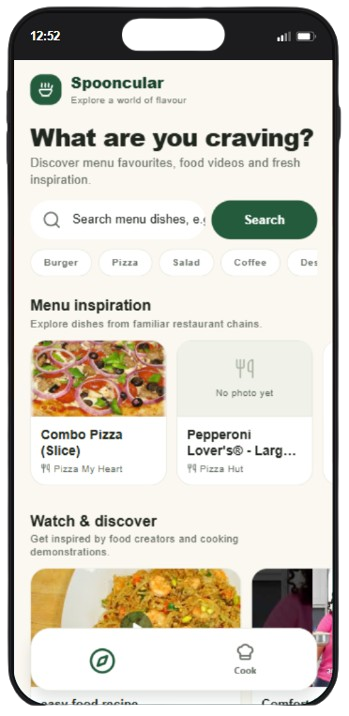
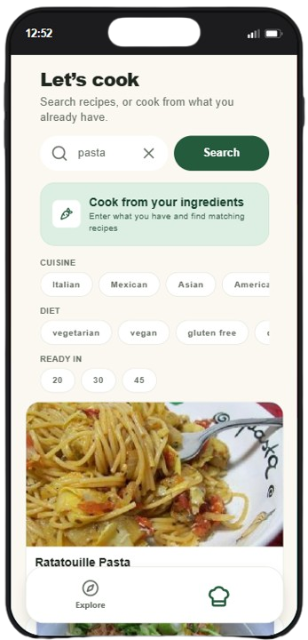
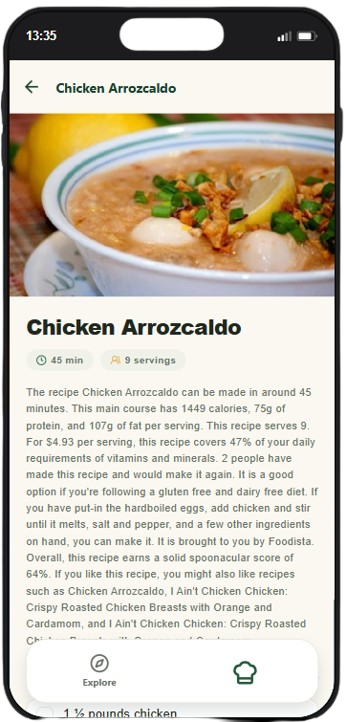
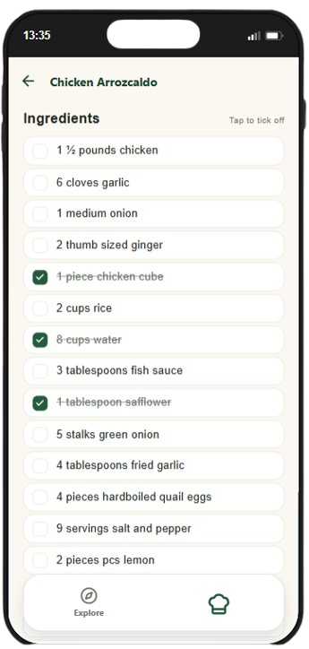
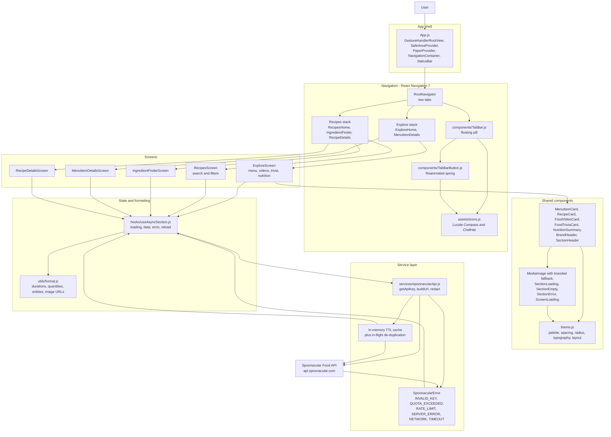
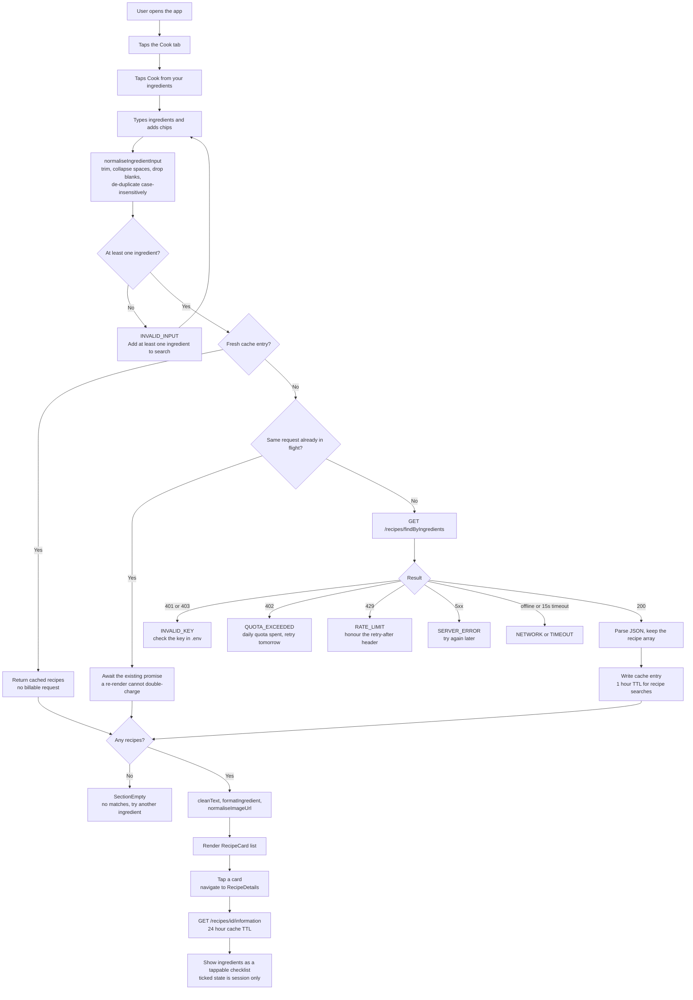
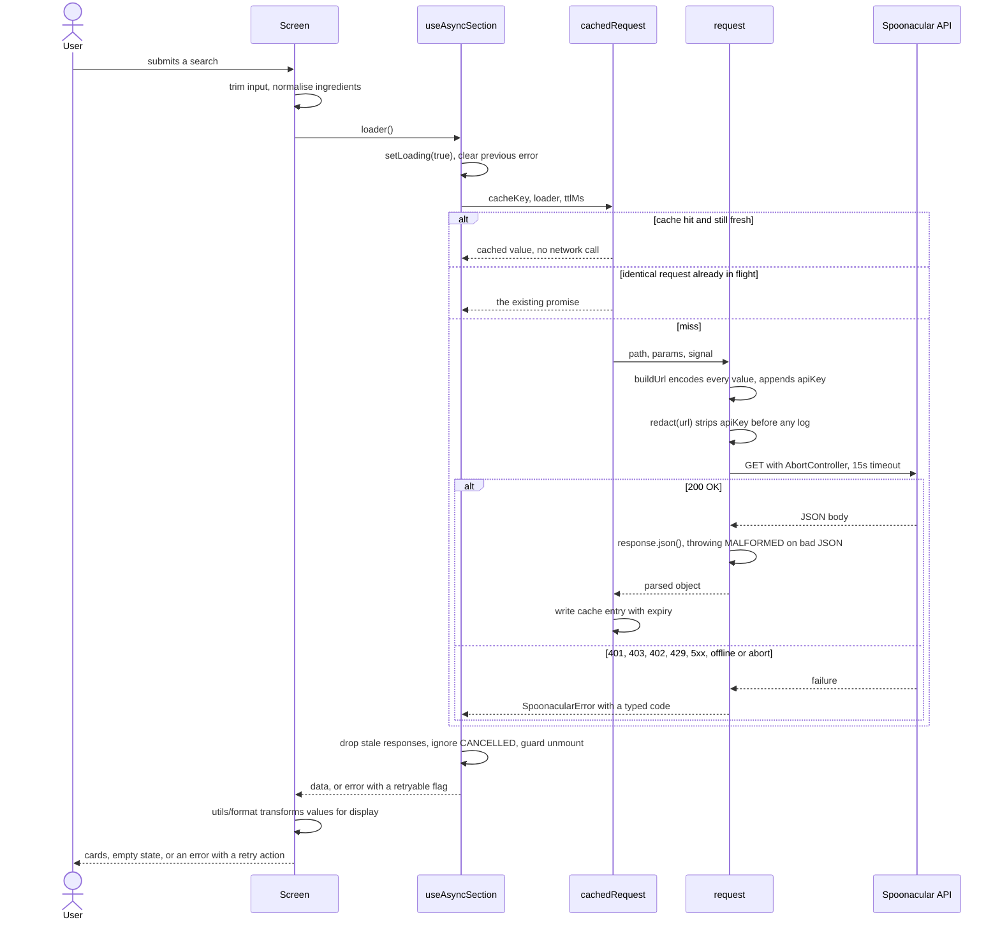

<div align="center">

# 🍲 Spooncular

### Explore what's on the menu. Cook with what you already have.

A two-tab food companion for iOS, Android and the web, powered entirely by the
Spoonacular Food API — restaurant-chain menu discovery on one side, real recipes
and step-by-step cooking on the other.

<br/>

<p>
  
</p>

<br/>


</div>

---

## 📑 Contents

- [Key features](#-key-features)
- [Screens](#-screens)
- [App demo](#-app-demo)
- [Architecture](#-architecture)
- [System architecture](#-system-architecture)
- [End-to-end flow](#-end-to-end-flow-cook-from-your-ingredients)
- [Data & API lifecycle](#-data--api-lifecycle)
- [Technology stack](#-technology-stack)
- [Project structure](#-project-structure)
- [Getting started](#-getting-started)
- [Scripts](#-scripts)
- [Testing](#-testing)
- [Design system](#-design-system)
- [Reliability rules](#-reliability-rules)
- [Known limitations](#-known-limitations)

---

## ✨ Key features

### Explore tab

| Section | What it does |
|---|---|
| **Menu inspiration** | Search restaurant-chain menu dishes, or tap a category chip (Burger, Pizza, Salad, Coffee, Dessert, Chicken, Vegetarian) to explore instantly. Results render as a peeking card carousel. |
| **Watch & discover** | Curated food videos that open the matching YouTube watch URL. |
| **Something to chew over** | A "fact of the day" that stays stable for 12 hours, with an explicit refresh action. |
| **Nutrition Lens** | Type a dish name and get an estimated macro breakdown, including the 95% confidence interval when the API returns one. |

Every section owns its own request and error state, so a single failing endpoint
never blanks the screen — the rest of the tab keeps working.

### Cook tab

| Section | What it does |
|---|---|
| **Recipe search** | Free-text search with cuisine, diet and ready-in filters (7 cuisines, 4 diets, 4 time budgets). |
| **Ingredient finder** | Add the ingredients you already have and get recipes you can make from them, with suggestion chips. |
| **Recipe detail** | Hero image, servings and time, the full ingredient list as a tappable checklist, and step-by-step method with nutrition totals. |

### Navigation

A custom **floating tab bar** built with Reanimated: a rounded pill that hovers
above the content, clear of the home indicator. Selecting a tab springs its icon
to 1.4× and travels 8pt downward while its label fades out; deselecting reverses it.

---

## 📱 Screens

The Cook flow, start to finish — search, recipe, then the ingredient checklist.

<table>
  <tr>
    <td align="center" width="33%">
      
      <br /><br />
      <sub><b>Search & filter</b><br/>Recipes tab with cuisine, diet and time filters</sub>
    </td>
    <td align="center" width="33%">
      
      <br /><br />
      <sub><b>Recipe detail</b><br/>Photo, timings, servings and summary</sub>
    </td>
    <td align="center" width="33%">
      
      <br /><br />
      <sub><b>Cook mode</b><br/>Tap ingredients to tick them off as you shop</sub>
    </td>
  </tr>
</table>

---

## 🎬 App demo

https://github.com/user-attachments/assets/a090f00d-75c4-4308-85ff-88aa7c3f5521

> GitHub does not stream repository-relative MP4 files inline, so the video is
> linked rather than embedded. Follow the link above to play or download it.

---

## 🏗 Architecture

Spooncular is a **client-only** app. There is no backend, no database and no
authentication — every request goes straight from the device to Spoonacular.

The code is organised in five strict layers, and each one only ever talks to the
one below it:

| Layer | Responsibility |
|---|---|
| **Navigation** | Two bottom tabs, each wrapping its own native stack, rendered through a custom animated tab bar. |
| **Screens** | Five screens that own their local UI state and compose shared components. |
| **Components** | Reusable cards, the branded image fallback, section headers, empty/error/loading states and the tab bar itself. |
| **Hook** | `useAsyncSection` — mount-scoped loading / data / error state with stale-response and unmount guards. |
| **Service** | `spoonacularApi.js` — the only module that reads the key, builds URLs, caches, and maps HTTP failures onto typed errors. |

There is no global state library. Data lives in React state for the lifetime of a
screen; the only cross-screen memory is the API module's in-memory TTL cache.

---

## 🧭 System architecture



---

## 🔄 End-to-end flow: Cook from your ingredients

The app's signature journey, from opening it to ticking off ingredients while
shopping. Every decision below is a real branch in the source.



---

## 📊 Data & API lifecycle

What happens to a single search, end to end.



### Cache TTLs

| Data | TTL |
|---|---|
| Menu item search | 30 minutes |
| Food videos | 1 hour |
| Recipe search / by-ingredients | 1 hour |
| Food fact of the day | 12 hours |
| Menu item and recipe detail | 24 hours |
| Nutrition estimate | *not cached* — always an explicit user action |

---

## 🧰 Technology stack

### Runtime

| Package | Version | Role |
|---|---|---|
| `expo` | ~57.0.0 | SDK, bundler and the `EXPO_PUBLIC_*` env pipeline |
| `react-native` | 0.86.3 | UI runtime |
| `react` | 19.2.3 | React runtime |
| `@react-navigation/native` | ^7.5.0 | Navigation container and theming |
| `@react-navigation/bottom-tabs` | ^7.20.0 | The two-tab shell |
| `@react-navigation/native-stack` | ^7.3.0 | Per-tab stacks with native back behaviour |
| `react-native-paper` | ^5.15.3 | Material Design 3 primitives, themed in `theme.js` |
| `react-native-reanimated` | 4.5.1 | The floating tab bar's spring animations |
| `react-native-safe-area-context` | ~5.7.0 | Safe-area insets for headers and the tab bar |
| `react-native-gesture-handler` | ~2.32.0 | Gesture root required by the navigators |
| `react-native-screens` | ~4.26.0 | Native screen containers |
| `react-native-svg` | 15.15.4 | Vector rendering behind the Lucide icon set |
| `lucide-react-native` | ^1.57.0 | **The only icon library in the project** |
| `react-native-web` | ^0.21.2 | Web target |
| `expo-constants`, `expo-font`, `expo-status-bar` | ~57.0.x | Expo runtime helpers |

### Tooling

| Package | Version | Role |
|---|---|---|
| `jest` / `jest-expo` | ~29.7.0 / ~57.0.6 | Test runner and Expo preset |
| `@testing-library/react-native` | ^13.3.3 | Component and screen tests |
| `react-test-renderer` | 19.2.3 | React renderer used by the testing library |
| `typescript` | ~6.0.3 | `tsc --noEmit` type checking |
| `puppeteer-core` | ^25.13.0 | Drives the installed browser to capture visual-verification screenshots |

---

## 📂 Project structure

```text
.
├── App.js                     Providers: gesture root, safe area, Paper, navigation
├── app.json                   Expo config (name, icons, splash, bundle ids)
├── theme.js                   Design tokens: palette, spacing, radius, typography, layout
├── navigation/
│   └── RootNavigator.js       Two tabs, each wrapping its own native stack
├── screens/
│   ├── ExploreScreen.js       Explore tab: menu, videos, trivia, Nutrition Lens
│   ├── MenuItemDetailsScreen.js  One menu dish and its nutrition
│   ├── RecipesScreen.js       Cook tab: recipe search with cuisine/diet/time filters
│   ├── IngredientFinderScreen.js Find recipes from ingredients on hand
│   └── RecipeDetailsScreen.js Recipe, ingredient checklist, method, nutrition
├── components/
│   ├── TabBar.js              Floating pill container and tab press handling
│   ├── TabBarButton.js        Reanimated icon scale, travel and label fade
│   ├── MediaImage.js          Validated image with a branded fallback panel
│   ├── MenuItemCard.js        Peeking carousel card for menu dishes
│   ├── RecipeCard.js          Recipe search result card
│   ├── FoodVideoCard.js       Video thumbnail with duration and view count
│   ├── FoodTriviaCard.js      "Fact of the day" card
│   ├── NutritionSummary.js    Two-up macro grid
│   ├── BrandHeader.js         Wordmark and strapline
│   ├── SectionHeader.js       Section title and supporting line
│   ├── StateViews.js          Loading, empty and error states
│   └── paperSettings.js       Maps Paper's internal icon resolver onto Lucide
├── hooks/
│   └── useAsyncSection.js     Mount-scoped async state with stale-response guards
├── services/
│   └── spoonacularApi.js      The only module that knows the API key
├── utils/
│   └── format.js              Durations, quantities, fractions, entities, image URLs
├── assets/
│   ├── icons.js               Tab icon map — single source of truth
│   └── *.png, *.mp4           App icons and README media
├── __tests__/                 Jest suites
├── jest.setup.js              Env loading, gesture, Reanimated test setup
└── capture*.cjs, serve-web.cjs  Local visual-verification tooling
```

---

## 🚀 Getting started

### Prerequisites

- Node.js 20 or newer
- npm
- A [Spoonacular](https://spoonacular.docs.apiary.io) API key (the free daily
  plan is enough for development)
- Expo Go on a physical device, or an iOS/Android simulator

### Install

```bash
git clone <your-repo-url>
cd mad9135-p2-react-native-final
npm install
```

### Configure the API key

```bash
cp .env.example .env
```

Then set a single variable in `.env`:

```dotenv
EXPO_PUBLIC_SPOONACULAR_API_KEY=your_key_here
```

| Variable | Required | Purpose |
|---|---|---|
| `EXPO_PUBLIC_SPOONACULAR_API_KEY` | Yes | Authenticates every request to the Spoonacular Food API |

> #### ⚠️ This key is **not** secret
>
> Expo inlines any `EXPO_PUBLIC_*` variable into the JavaScript bundle, so anyone
> who inspects the shipped app can extract it. Treat it as a public client
> credential and rotate it if it is exposed. Keeping it genuinely private would
> require a backend proxy, which this project deliberately does not add.
>
> `.env` is gitignored. Never commit the key or paste it into source, logs or
> screenshots.

The app still renders without a key — each section shows a clear "key is not
configured" message instead of failing silently.

### Run

```bash
npm start          # Expo dev server
npm run ios        # iOS simulator
npm run android    # Android emulator
npm run web        # browser
```

---

## 📜 Scripts

| Command | Purpose |
|---|---|
| `npm start` | Start the Expo dev server |
| `npm run ios` | Start on the iOS simulator |
| `npm run android` | Start on an Android emulator |
| `npm run web` | Start in the browser |
| `npm test` | Run the Jest suite |
| `npm run typecheck` | Run `tsc --noEmit` |

---

## 🧪 Testing

```bash
npm test
```

**110 tests across 5 suites.** `fetch` is mocked, so running the suite spends no
API quota.

| Suite | Covers |
|---|---|
| `spoonacularApi.test.js` | URL encoding, key redaction, HTTP-to-error mapping, cache TTLs, refresh and in-flight de-duplication, input normalisation |
| `format.test.js` | Durations, fraction glyphs, units, both real nutrition payload shapes, HTML entities, image URL normalisation |
| `icons.test.js` | That every Lucide icon name used by the app actually exists — a typo fails here rather than at render time |
| `screens.test.js` | Search, navigation, empty, error and per-section-failure states |
| `tabBar.test.js` | Routes and labels preserved, theme colours used rather than hardcoded ones, accessibility roles and selected state, press and long-press wiring, and the animation constants |

Reanimated needs its native worklets module mocked under Jest. `jest.setup.js`
calls `setUpTests()`, and `package.json` maps `react-native-worklets` to the mock
shipped with that package:

```json
"moduleNameMapper": {
  "^lucide-react-native$": "<rootDir>/node_modules/lucide-react-native/dist/cjs/lucide-react-native.js",
  "^react-native-worklets$": "<rootDir>/node_modules/react-native-worklets/lib/module/mock.js"
}
```

---

## 🎨 Design system

All visual values live in `theme.js`. No screen declares its own colour or
measurement.

### Palette

| Token | Hex | Use |
|---|---|---|
| `primary` | `#245B3D` | Brand green — active tab icon, primary actions |
| `primaryDark` | `#17412C` | Header tint, `onPrimaryContainer` |
| `primaryLight` | `#DDEFE2` | Selected chip and container surfaces |
| `secondary` | `#E7A84B` | Warm culinary accent |
| `background` | `#FBF8F1` | Warm cream page |
| `surface` | `#FFFFFF` | Cards and the tab bar |
| `surfaceMuted` | `#F0F2E9` | Image fallback panels |
| `text` | `#20271F` | Primary text |
| `textSecondary` | `#697268` | Supporting text, inactive tab icon |
| `border` | `#E3E6DC` | Hairlines |
| `error` | `#B93838` | Error state |

### Scales

| Scale | Values |
|---|---|
| `spacing` | 4, 8, 12, 16, 20, 24, 32 |
| `radius` | 8, 14, 20, pill (999) |
| `typography` | hero 30, title 25, section 19, card 16, body 15, supporting 13, meta 11.5 |
| `layout` | 20pt gutters, 48pt controls, 44pt touch targets, 16:9 media, 720pt max content width |

---

## 🛡 Reliability rules

These are product decisions, not incidental behaviour — they are enforced in the
code and covered by tests.

- **Nothing is invented.** Every dish name, photo, nutrition figure and
  instruction comes from the API response. No placeholder dishes, no substituted
  photos, no generated amounts.
- **Missing images get a designed fallback.** `MediaImage` validates the URL and,
  when an image is absent or fails to load, renders a branded panel with a
  `CookingPot` or `Utensils` icon rather than a broken image or a different dish's
  photo.
- **Amounts are faithful.** `formatQuantity` renders `0.33333334 cup` as `⅓ cup`,
  but only when the value is a genuine fraction match — it never rounds a
  meaningful number into a misleading one. Units are echoed exactly as supplied.
- **Both nutrition shapes are handled.** `/recipes/guessNutrition` returns
  `{ value, unit }` with a `carbs` key; recipe and menu nutrition return
  `{ amount, unit }` with `carbohydrates`. Both are accepted, and the 95%
  confidence interval is shown when present.
- **Text is cleaned before display.** `cleanText` strips markup and decodes HTML
  entities, including semicolon-less forms such as `&reg`.
- **Keys never leak.** `redact()` strips `apiKey` from any URL before it reaches
  a log or an error message.
- **One failure never takes down the screen.** Each section has independent
  loading and error state, so a 402 on one endpoint leaves the rest of the tab
  working.

---

## ⚠️ Known limitations

- **The API key ships inside the bundle.** Inherent to a client-only Expo app
  using `EXPO_PUBLIC_*`; see the note above.
- **Video cards open YouTube externally** rather than embedding a player, which
  follows the YouTube terms Spoonacular's documentation points to.
- **Menu search is not proximity-aware.** Results are chain-wide menu items, not
  local restaurant listings, and the app labels them that way.
- **The ingredient checklist is session-only.** Ticked ingredients live in React
  state and are deliberately not persisted across app restarts.
- **No offline support.** The in-memory cache only lives for the current
  process.

---

## 🙏 Acknowledgements

- [Spoonacular Food API](https://spoonacular.docs.apiary.io) — all recipe, menu,
  video, trivia and nutrition data
- [Expo](https://expo.dev) and [React Native](https://reactnative.dev)
- [React Native Paper](https://callstack.github.io/react-native-paper/) — Material Design 3
- [Lucide](https://lucide.dev) — the icon set

---

<div align="center">
  <sub>Built with Expo, React Native and the Spoonacular Food API.</sub>
</div>
